# Awesome Claude Code Review

[中文](README.zh-CN.md)

Open-source **AI code review skills and tools** for Claude Code, Codex and other agents: review skills, local and CLI reviewers, PR review bots and CI actions, multi-agent review, security review, self-hosted platforms. 185 repos, each one read and security-graded by [Agent Skills Hub (agentskillshub.top)](https://agentskillshub.top?utm_source=github&utm_medium=awesome-list).

Live page with filters: **[https://agentskillshub.top/best/code-review/](https://agentskillshub.top/best/code-review/?utm_source=github&utm_medium=awesome-list)** · refreshed every 8 hours

## Which one to install

We ran 16 of these end to end (13 gave a result). This is what we would pick; the [full test](#tested) is below.

- 🥇 **If you want a review skill at all: [code-review-skill](https://github.com/awesome-skills/code-review-skill)**  
  Found all eight planted defects with no false alarm on the clean pull requests, in about a minute and under two findings per pull request. That equals Claude Code with nothing installed: it adds a written checklist and a fixed report format, not detection.
- 🥈 **If you want every commit reviewed without asking: [roborev](https://github.com/kenn-io/roborev)**  
  It reviews in the background as you commit, and it found all eight even with a different model (gpt-6-astra) doing the reading, with under one finding per pull request. Slower: 13 minutes for the twelve.
- 🥉 **If you would rather wait than read noise: [adamsreview](https://github.com/adamjgmiller/adamsreview)**  
  The quietest reviewer that missed nothing it finished: 0.5 findings per pull request, the defect found in all seven it completed. It ran out of our 30 minutes on the twelfth.

**Know what these do not look for:** brooks-lint (design decay only; it passed a logged card token at 100/100); bug-hunter (ignores test files, so a weakened test goes through).

Whichever you pick, the hardest defect was not in the code: four of 13 reviewers passed a pull request that quietly weakened a test's assertion. Read test changes yourself.

*Listed by defects found, then time. This set does not rank the tools at the top: Claude Code with no tool installed found all 8 planted defects in a minute with no false alarm, and six tools did the same. Tools that bring their own model reviewed with gpt-6-astra, the skills with Claude Opus 5.5, so a gap between those two groups may be the model.*

## What these reviewers look like

<table>
<tr>
<td align="center" valign="top" width="33%"><b>🔁 PR review bots & CI</b> 39 repos  <a href="https://github.com/truongnh1992/gemini-ai-code-reviewer">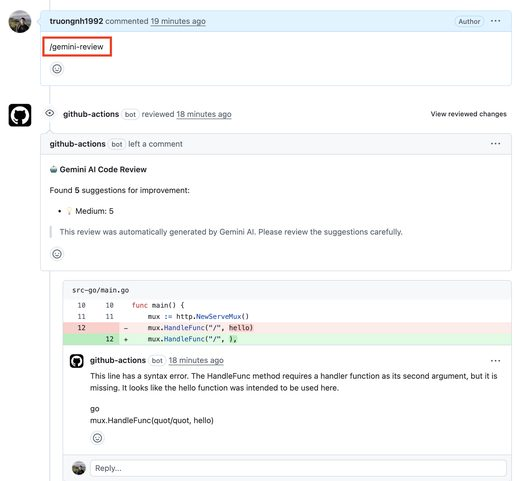</a> Bots and CI actions that comment on every pull request. <a href="#type-pr_bot"><b>View the list →</b></a></td>
<td align="center" valign="top" width="33%"><b>🧩 Code review skills</b> 30 repos   Skills and plugins that have Claude Code or Codex review a diff. <a href="#type-skill"><b>View the list →</b></a></td>
<td align="center" valign="top" width="33%"><b>⌨️ Local & CLI review</b> 65 repos  <a href="https://github.com/persiyanov/herdr-reviewr">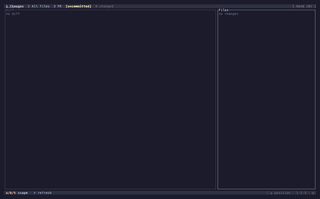</a> Reviewers you run locally on a branch or a diff. <a href="#type-cli"><b>View the list →</b></a></td>
</tr>
<tr>
<td align="center" valign="top" width="33%"><b>🛡 Security review</b> 16 repos  <a href="https://github.com/DeepCodeAI/vscode-extension">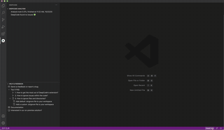</a> Agents that look for vulnerabilities, some in a sandbox. <a href="#type-security"><b>View the list →</b></a></td>
<td align="center" valign="top" width="33%"><b>👥 Multi-agent review</b> 26 repos  <a href="https://github.com/syabro/rejudge">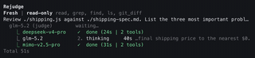</a> Several reviewers or models on the same change. <a href="#type-multi"><b>View the list →</b></a></td>
<td align="center" valign="top" width="33%"><b>🏗 Code review platforms</b> 9 repos  <a href="https://github.com/imDarshanGK/AI-dev-assistant">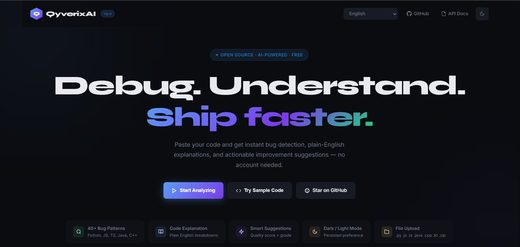</a> Self-hosted services that review across a team's repositories. <a href="#type-platform"><b>View the list →</b></a></td>
</tr>
</table>

## Contents

- [🧪 Tested end to end](#tested)
- [🔁 PR review bots & CI](#type-pr_bot) (39)
- [🧩 Code review skills](#type-skill) (30)
- [⌨️ Local & CLI review](#type-cli) (65)
- [🛡 Security review](#type-security) (16)
- [👥 Multi-agent review](#type-multi) (26)
- [🏗 Code review platforms](#type-platform) (9)

## How a repo gets on the list

1. It reviews code with an AI model: a diff, a pull request or a codebase, for bugs, security or quality. A tool that only writes code, a linter with no model, or a general coding agent does not count.
2. It is software someone can install or run, not a list of links or a placeholder.
3. It has a README. Without one it cannot be graded.
4. At 50 stars or more it is listed on topic alone. Under 50 it must also clear a README quality bar (shows it working, one-command start, a concrete outcome, complete docs), and have 5 stars.

The questions are answered by a decision model reading each README, not by hand. A repo near a cut-off can land on either side; open an issue if one is misfiled.

## 🧪 Tested end to end

On 2026-10-10 we ran 16 of these tools and 13 ran. Each reviewed the same 12 pull requests against a small Python service in a throwaway sandbox: 8 carry one planted defect (an off-by-one, an SQL injection, a card token in the logs, a missing permission check, a retry that never ends, a swallowed error, an inverted condition, a weakened test) and 4 are clean. Two numbers per tool, as in SWR-Bench: defects found, and blocking findings on the clean ones. A judge (gpt-6-astra, three passes) marked each review. Claude Code with no tool installed did the same job as a control.

**What we found:** No tool beat the control. Claude Code with nothing installed found all 8 defects in about a minute with no false alarm (1.8 findings per pull request); 6 tools matched it and none did better. What separates the tools is noise (0.5 to 7.2 findings per pull request) and time (1 to 30 minutes). The defect missed most was the weakened test: 4 of 13 let it through.

| # | Tool | ★ | Defects found (of 8) | False alarms on 4 clean PRs | Findings per PR | Time | Reviewed by |  |
|---|---|---|---|---|---|---|---|---|
| 1 | [code-review-skill](https://github.com/awesome-skills/code-review-skill) | 1,914 | 8/8 | 0 | 1.8 | 1 min | Claude Opus 5.5 | [evidence](https://agentskillshub.top/best-runs/review/awesome-skills__code-review-skill.html) |
| 2 | [guard-skills](https://github.com/amElnagdy/guard-skills) | 1,153 | 8/8 | 0 | 1.4 | 2 min | Claude Opus 5.5 | [evidence](https://agentskillshub.top/best-runs/review/amElnagdy__guard-skills.html) |
| 3 | [review-forge](https://github.com/vikingmute/review-forge) | 220 | 8/8 | 0 | 1.3 | 2 min | Claude Opus 5.5 | [evidence](https://agentskillshub.top/best-runs/review/vikingmute__review-forge.html) |
| 4 | [clean-architecture-skills](https://github.com/nathankim0/clean-architecture-skills) | 90 | 8/8 | 0 | 2.7 | 2 min | Claude Opus 5.5 | [evidence](https://agentskillshub.top/best-runs/review/nathankim0__clean-architecture-skills.html) |
| 5 | [open-code-review](https://github.com/spencermarx/open-code-review) | 331 | 8/8 | 0 | 7.2 | 11 min | Claude Opus 5.5 | [evidence](https://agentskillshub.top/best-runs/review/spencermarx__open-code-review.html) |
| 6 | [roborev](https://github.com/kenn-io/roborev) | 1,746 | 8/8 | 0 | 0.9 | 13 min | gpt-6-astra | [evidence](https://agentskillshub.top/best-runs/review/kenn-io__roborev.html) |
| 7 | [adamsreview](https://github.com/adamjgmiller/adamsreview) | 243 | 7/7 | 0 | 0.5 | 30 min | Claude Opus 5.5 | [evidence](https://agentskillshub.top/best-runs/review/adamjgmiller__adamsreview.html) |
| 8 | [bug-hunter](https://github.com/codexstar69/bug-hunter) | 487 | 7/8 | 0 | 0.8 | 3 min | Claude Opus 5.5 | [evidence](https://agentskillshub.top/best-runs/review/codexstar69__bug-hunter.html) |
| 9 | [open-code-review](https://github.com/alibaba/open-code-review) | 43,912 | 7/8 | 0 | 0.6 | 7 min | gpt-6-astra | [evidence](https://agentskillshub.top/best-runs/review/alibaba__open-code-review.html) |
| 10 | [vet](https://github.com/imbue-ai/vet) | 519 | 7/8 | 0 | 1.1 | 18 min | gpt-6-astra | [evidence](https://agentskillshub.top/best-runs/review/imbue-ai__vet.html) |
| 11 | [brooks-lint](https://github.com/hyhmrright/brooks-lint) | 1,506 | 5/8 | 0 | 0.9 | 3 min | Claude Opus 5.5 | [evidence](https://agentskillshub.top/best-runs/review/hyhmrright__brooks-lint.html) |
| 12 | [gentleman-guardian-angel](https://github.com/Gentleman-Programming/gentleman-guardian-angel) | 1,180 | 5/8 | see note | 6.0 | 9 min | gpt-6-astra | [evidence](https://agentskillshub.top/best-runs/review/Gentleman-Programming__gentleman-guardian-angel.html) |
| 13 | [warden](https://github.com/getsentry/warden) | 414 | 4/8 | 0 | 0.5 | 25 min | gpt-6-astra | [evidence](https://agentskillshub.top/best-runs/review/getsentry__warden.html) |

**Could not run:** cynical-sally (It sends the diff to its own hosted service, which answered Service Unavailable.); git-lrc (It sends the diff to a LiveReview server; there is none to review with locally.); claude-pr-review (It reviews pull requests on Bitbucket through the Bitbucket API; it has no way to review a local branch.)

[All results, prompts and scripts](https://github.com/zhuyansen/agent-skills-hub/blob/main/ops/review-runs/RESULTS.md) · [https://agentskillshub.top/best/code-review/#test-results](https://agentskillshub.top/best/code-review/?utm_source=github&utm_medium=awesome-list#test-results)

## 🔁 PR review bots & CI

[Open this type on the live page, sorted by stars →](https://agentskillshub.top/best/code-review/?utm_source=github&utm_medium=awesome-list#type-pr_bot)

<table><tr>
<td align="center" valign="top"><a href="https://github.com/The-PR-Agent/pr-agent">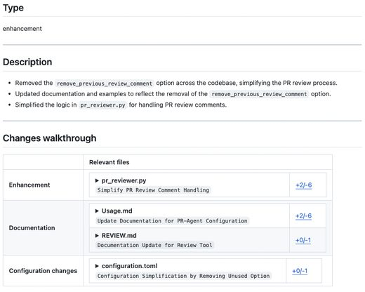</a> <a href="https://github.com/The-PR-Agent/pr-agent">The-PR-Agent/pr-agent</a></td>
<td align="center" valign="top"><a href="https://github.com/Nayjest/Gito">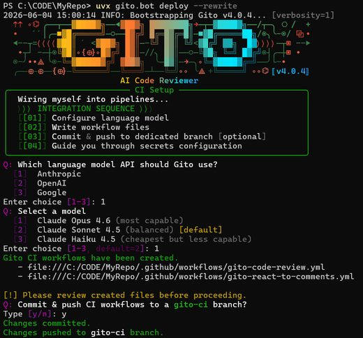</a> <a href="https://github.com/Nayjest/Gito">Nayjest/Gito</a></td>
<td align="center" valign="top"> <a href="https://github.com/sturdy-dev/codeball-action">sturdy-dev/codeball-action</a></td>
</tr></table>

| Repo | Stars | What it does | Security |
|---|---:|---|---|
| [The-PR-Agent/pr-agent](https://github.com/The-PR-Agent/pr-agent) | 13.6k | 🚀 PR Agent: The Original Open-Source PR Reviewer. This project is not the Qodo free tier. | [SAFE](https://agentskillshub.top/skill/The-PR-Agent/pr-agent/?utm_source=github&utm_medium=awesome-list) |
| [mattzcarey/shippie](https://github.com/mattzcarey/shippie) | 2.5k | extendable code review and QA agent 🚢 | [SAFE](https://agentskillshub.top/skill/mattzcarey/shippie/?utm_source=github&utm_medium=awesome-list) |
| [sourcery-ai/sourcery](https://github.com/sourcery-ai/sourcery) | 1.9k | Instant AI code reviews | [SAFE](https://agentskillshub.top/skill/sourcery-ai/sourcery/?utm_source=github&utm_medium=awesome-list) |
| [vercel-labs/openreview](https://github.com/vercel-labs/openreview) | 1.7k | An open-source, self-hosted AI code review bot powered by Vercel. | [SAFE](https://agentskillshub.top/skill/vercel-labs/openreview/?utm_source=github&utm_medium=awesome-list) |
| [villesau/ai-codereviewer](https://github.com/villesau/ai-codereviewer) | 1.0k | AI Code Reviewer: Enhance your GitHub workflow with AI-powered code review! Get intelligent feedback and suggestions on pull requests using OpenAI's… | [SAFE](https://agentskillshub.top/skill/villesau/ai-codereviewer/?utm_source=github&utm_medium=awesome-list) |
| [Nikita-Filonov/ai-review](https://github.com/Nikita-Filonov/ai-review) | 599 | 🚀 AI-powered code review tool for GitHub, GitLab, Bitbucket Cloud, Bitbucket Server, Azure DevOps and Gitea — built with LLMs like OpenAI, Claude, Ge… | [SAFE](https://agentskillshub.top/skill/Nikita-Filonov/ai-review/?utm_source=github&utm_medium=awesome-list) |
| [Nayjest/Gito](https://github.com/Nayjest/Gito) | 455 | An AI-powered GitHub code review tool that uses LLMs to detect high-confidence, high-impact issues—such as security vulnerabilities, bugs, and mainta… | [SAFE](https://agentskillshub.top/skill/Nayjest/Gito/?utm_source=github&utm_medium=awesome-list) |
| [cirolini/genai-code-review](https://github.com/cirolini/genai-code-review) | 372 | GitHub Action that reviews pull request diffs with an LLM and posts the comments on the PR | [SAFE](https://agentskillshub.top/skill/cirolini/genai-code-review/?utm_source=github&utm_medium=awesome-list) |
| [sturdy-dev/codeball-action](https://github.com/sturdy-dev/codeball-action) | 327 | 🔮 Codeball – AI Code Review that finds bugs and fast-tracks your code | [SAFE](https://agentskillshub.top/skill/sturdy-dev/codeball-action/?utm_source=github&utm_medium=awesome-list) |
| [gitbito/bitoai](https://github.com/gitbito/bitoai) | 300 | Get codebase-aware feedback in your GitHub, GitLab, Bitbucket pull requests or directly in your IDE. | [SAFE](https://agentskillshub.top/skill/gitbito/bitoai/?utm_source=github&utm_medium=awesome-list) |
| [Cloudflare-Studio/ask-bonk](https://github.com/Cloudflare-Studio/ask-bonk) | 267 | Bonk is a code & docs agent that can build, review and triage for you, built on Cloudflare Workers & OpenCode. | [SAFE](https://agentskillshub.top/skill/Cloudflare-Studio/ask-bonk/?utm_source=github&utm_medium=awesome-list) |
| [truongnh1992/gemini-ai-code-reviewer](https://github.com/truongnh1992/gemini-ai-code-reviewer) | 257 | A GitHub Action that automatically reviews pull requests using Google's Gemini AI. | [SAFE](https://agentskillshub.top/skill/truongnh1992/gemini-ai-code-reviewer/?utm_source=github&utm_medium=awesome-list) |
| [spherical-up/Easy-AI-CodeReview](https://github.com/spherical-up/Easy-AI-CodeReview) | 243 | 这是一个专为开发者打造的高效 Code Review 工具，旨在提升代码审查质量、降低沟通成本，并加速团队协作流程。通过智能比对、注释建议、变更摘要、代码质量提示等功能，帮助开发者更快地理解提交内容、发现潜在问题，让每一次 Review 更加清晰、高效、有价值。 | [SAFE](https://agentskillshub.top/skill/spherical-up/Easy-AI-CodeReview/?utm_source=github&utm_medium=awesome-list) |
| [flows-network/github-pr-summary](https://github.com/flows-network/github-pr-summary) | 229 | Use LLM to summarize & review GitHub Pull Requests | [SAFE](https://agentskillshub.top/skill/flows-network/github-pr-summary/?utm_source=github&utm_medium=awesome-list) |
| [presubmit/ai-reviewer](https://github.com/presubmit/ai-reviewer) | 187 | Context-aware AI reviewer for Pull Requests. Instant summary, line-by-line comments, title generation and more | [SAFE](https://agentskillshub.top/skill/presubmit/ai-reviewer/?utm_source=github&utm_medium=awesome-list) |
| [Juror-AI/juror](https://github.com/Juror-AI/juror) | 117 | Cheaper and better Greptile alternative runs on your own github actions. | [SAFE](https://agentskillshub.top/skill/Juror-AI/juror/?utm_source=github&utm_medium=awesome-list) |
| [octopusreview/octopus](https://github.com/octopusreview/octopus) | 114 | AI-powered PR review tool — multi-armed code analysis, no bug escapes 🐙 | [SAFE](https://agentskillshub.top/skill/octopusreview/octopus/?utm_source=github&utm_medium=awesome-list) |
| [mr-karan/hodor](https://github.com/mr-karan/hodor) | 112 | Agentic code reviewer for GitHub PRs and GitLab MRs. Multi-step reasoning with autonomous tool orchestration — catches bugs requiring analysis across… | [SAFE](https://agentskillshub.top/skill/mr-karan/hodor/?utm_source=github&utm_medium=awesome-list) |
| [qiniu/reviewbot](https://github.com/qiniu/reviewbot) | 106 | Empower Your Code Quality with Self-Hosted Automated Analysis and Review | [SAFE](https://agentskillshub.top/skill/qiniu/reviewbot/?utm_source=github&utm_medium=awesome-list) |
| [nfacha/OpenAI-Gitlab-PR-Review](https://github.com/nfacha/OpenAI-Gitlab-PR-Review) | 94 | Prototype Gitlab Webook that submits code to OpenAI for review | [SAFE](https://agentskillshub.top/skill/nfacha/OpenAI-Gitlab-PR-Review/?utm_source=github&utm_medium=awesome-list) |
| [Usagi-org/ai-code-review-helper](https://github.com/Usagi-org/ai-code-review-helper) | 92 | AI Code Review Helper 是一个旨在自动化代码审查流程的工具。它通过集成版本控制系统（如 GitHub 和 GitLab）的 Webhook，利用大型语言模型（LLM）对代码变更进行分析，并将审查意见反馈到相应的 Pull Request 或 Merge Request 中。此外… | [SAFE](https://agentskillshub.top/skill/Usagi-org/ai-code-review-helper/?utm_source=github&utm_medium=awesome-list) |
| [buxuku/ai-code-reviewer](https://github.com/buxuku/ai-code-reviewer) | 90 | 一个利用 openai api 对 gitlab 提交的 merge request 进行 code review 的小工具 | [SAFE](https://agentskillshub.top/skill/buxuku/ai-code-reviewer/?utm_source=github&utm_medium=awesome-list) |
| [feiskyer/ChatGPT-Reviewer](https://github.com/feiskyer/ChatGPT-Reviewer) | 90 | Automated pull requests reviewing and issues triaging with ChatGPT. | [SAFE](https://agentskillshub.top/skill/feiskyer/ChatGPT-Reviewer/?utm_source=github&utm_medium=awesome-list) |
| [zixingtangmouren/mr-agent](https://github.com/zixingtangmouren/mr-agent) | 89 | mr-agent: A Node.js service that auto-triggers AI-powered code reviews when receiving Git merge request webhook events. Integrates with GitHub/GitLab… | [SAFE](https://agentskillshub.top/skill/zixingtangmouren/mr-agent/?utm_source=github&utm_medium=awesome-list) |
| [adshao/chatgpt-code-review-action](https://github.com/adshao/chatgpt-code-review-action) | 80 | A GitHub Action that uses OpenAI ChatGPT to do code review | [SAFE](https://agentskillshub.top/skill/adshao/chatgpt-code-review-action/?utm_source=github&utm_medium=awesome-list) |
| [ccsert/opencode-review-gitea](https://github.com/ccsert/opencode-review-gitea) | 76 | AI-powered PR review for Gitea/Forgejo built on OpenCode. Runs in Gitea Actions, fetches PR diffs, and posts structured reviews. Supports Docker or s… | [SAFE](https://agentskillshub.top/skill/ccsert/opencode-review-gitea/?utm_source=github&utm_medium=awesome-list) |
| [truskovskiyk/pr-reviewer](https://github.com/truskovskiyk/pr-reviewer) | 73 | Use LLM to help you with PR review | [SAFE](https://agentskillshub.top/skill/truskovskiyk/pr-reviewer/?utm_source=github&utm_medium=awesome-list) |
| [gitbito/CodeReviewAgent](https://github.com/gitbito/CodeReviewAgent) | 67 | On-demand, context-aware AI code reviews in your Git workflow or IDE as you code. | [SAFE](https://agentskillshub.top/skill/gitbito/CodeReviewAgent/?utm_source=github&utm_medium=awesome-list) |
| [gitpack-ai/gitpack-ai](https://github.com/gitpack-ai/gitpack-ai) | 67 | Automate Pull Request Reviews with AI 🪄 | [SAFE](https://agentskillshub.top/skill/gitpack-ai/gitpack-ai/?utm_source=github&utm_medium=awesome-list) |
| [Integral-Healthcare/robin-ai-reviewer](https://github.com/Integral-Healthcare/robin-ai-reviewer) | 65 | Robin is your AI pull request reviewer in the form of a super fast lightweight github action. | [SAFE](https://agentskillshub.top/skill/Integral-Healthcare/robin-ai-reviewer/?utm_source=github&utm_medium=awesome-list) |
| [furudo-erika/codingfox](https://github.com/furudo-erika/codingfox) | 64 | Open Source AI Code Review Tool that Works Like Magic! | [SAFE](https://agentskillshub.top/skill/furudo-erika/codingfox/?utm_source=github&utm_medium=awesome-list) |
| [snarktank/ai-pr-review](https://github.com/snarktank/ai-pr-review) | 62 | A robust GitHub Actions workflow that provides AI-powered code reviews using Amp or Claude Code | [SAFE](https://agentskillshub.top/skill/snarktank/ai-pr-review/?utm_source=github&utm_medium=awesome-list) |
| [aryanbrite/openrabbit](https://github.com/aryanbrite/openrabbit) | 60 | Free, AI PR reviewer that runs entirely in GitHub Actions. No hosting required. | [SAFE](https://agentskillshub.top/skill/aryanbrite/openrabbit/?utm_source=github&utm_medium=awesome-list) |
| [Aestheticsuraj234/chai-ai-code-reviewer](https://github.com/Aestheticsuraj234/chai-ai-code-reviewer) | 59 |  | [SAFE](https://agentskillshub.top/skill/Aestheticsuraj234/chai-ai-code-reviewer/?utm_source=github&utm_medium=awesome-list) |
| [Factory-AI/droid-code-review](https://github.com/Factory-AI/droid-code-review) | 54 | Droid code review | [SAFE](https://agentskillshub.top/skill/Factory-AI/droid-code-review/?utm_source=github&utm_medium=awesome-list) |
| [ellenhp/auditlm](https://github.com/ellenhp/auditlm) | 52 | Self-hostable AI code review for your Forgejo | [SAFE](https://agentskillshub.top/skill/ellenhp/auditlm/?utm_source=github&utm_medium=awesome-list) |
| [electricsheephq/evaos-code-review-bot-neondiff](https://github.com/electricsheephq/evaos-code-review-bot-neondiff) | 51 | Stop giving away your code. NeonDIFF is your local-first AI PR reviewer for teams that want professional quality code reviews and issue enrichment wi… | [SAFE](https://agentskillshub.top/skill/electricsheephq/evaos-code-review-bot-neondiff/?utm_source=github&utm_medium=awesome-list) |
| [selimozten/elek](https://github.com/selimozten/elek) | 19 | Review-only AI code review for GitHub pull requests. Cross-check PRs with model-agnostic reviewers that can comment inline but cannot approve, merge,… | [SAFE](https://agentskillshub.top/skill/selimozten/elek/?utm_source=github&utm_medium=awesome-list) |
| [diffpal/diffpal](https://github.com/diffpal/diffpal) | 9 | Open-source, provider-agnostic AI review for pull requests. | [SAFE](https://agentskillshub.top/skill/diffpal/diffpal/?utm_source=github&utm_medium=awesome-list) |

## 🧩 Code review skills

[Open this type on the live page, sorted by stars →](https://agentskillshub.top/best/code-review/?utm_source=github&utm_medium=awesome-list#type-skill)

<table><tr>
<td align="center" valign="top"> <a href="https://github.com/hyhmrright/brooks-lint">hyhmrright/brooks-lint</a></td>
<td align="center" valign="top"><a href="https://github.com/fivetaku/insane-review">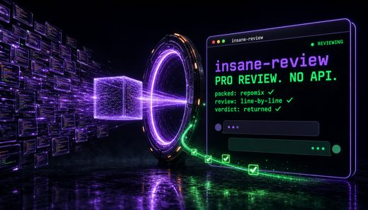</a> <a href="https://github.com/fivetaku/insane-review">fivetaku/insane-review</a></td>
<td align="center" valign="top"><a href="https://github.com/nathankim0/clean-architecture-skills">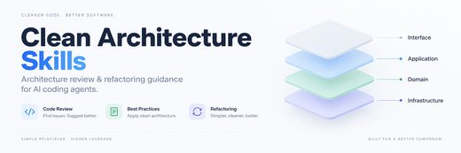</a> <a href="https://github.com/nathankim0/clean-architecture-skills">nathankim0/clean-architecture-skills</a></td>
</tr></table>

| Repo | Stars | What it does | Security |
|---|---:|---|---|
| [openai/codex-plugin-cc](https://github.com/openai/codex-plugin-cc) | 34.6k | Use Codex from Claude Code to review code or delegate tasks. | [SAFE](https://agentskillshub.top/skill/openai/codex-plugin-cc/?utm_source=github&utm_medium=awesome-list) |
| [awesome-skills/code-review-skill](https://github.com/awesome-skills/code-review-skill) | 2.1k | A comprehensive code review skill for Claude Code, covering React 19, Vue 3, Rust, TypeScript, TanStack Query v5, and more. | [SAFE](https://agentskillshub.top/skill/awesome-skills/code-review-skill/?utm_source=github&utm_medium=awesome-list) |
| [hyhmrright/brooks-lint](https://github.com/hyhmrright/brooks-lint) | 1.5k | Portable AI code quality reviews for Codex, Cursor, Copilot and other coding agents: six Agent Skills for architecture, technical debt, tests and rem… | [SAFE](https://agentskillshub.top/skill/hyhmrright/brooks-lint/?utm_source=github&utm_medium=awesome-list) |
| [amElnagdy/guard-skills](https://github.com/amElnagdy/guard-skills) | 1.3k | Guard skills for coding agents, quality gates that catch AI-generated failure modes in code, tests, and docs | [SAFE](https://agentskillshub.top/skill/amElnagdy/guard-skills/?utm_source=github&utm_medium=awesome-list) |
| [hamelsmu/claude-review-loop](https://github.com/hamelsmu/claude-review-loop) | 726 | Claude Code plugin: automated code review loop with Codex | [SAFE](https://agentskillshub.top/skill/hamelsmu/claude-review-loop/?utm_source=github&utm_medium=awesome-list) |
| [AsyncFuncAI/AsyncReview](https://github.com/AsyncFuncAI/AsyncReview) | 459 | Open-source Agentic code review tool inspired by DevinReview, using Recursive Language Models (RLM) | [SAFE](https://agentskillshub.top/skill/AsyncFuncAI/AsyncReview/?utm_source=github&utm_medium=awesome-list) |
| [greptileai/skills](https://github.com/greptileai/skills) | 428 | Agent skill for checking PR review comments, status checks, and description completeness | [SAFE](https://agentskillshub.top/skill/greptileai/skills/?utm_source=github&utm_medium=awesome-list) |
| [vikingmute/review-forge](https://github.com/vikingmute/review-forge) | 224 | review-forge is an Agent Skill for structured, auditable code review workflows | [SAFE](https://agentskillshub.top/skill/vikingmute/review-forge/?utm_source=github&utm_medium=awesome-list) |
| [Continuum-AI-Corp/Orca-Code-Review](https://github.com/Continuum-AI-Corp/Orca-Code-Review) | 180 | OrcaCode Review — the open code review harness. Multi-model reviews, merge gates, and no markup. Pay only for inference. | [SAFE](https://agentskillshub.top/skill/Continuum-AI-Corp/Orca-Code-Review/?utm_source=github&utm_medium=awesome-list) |
| [fivetaku/insane-review](https://github.com/fivetaku/insane-review) | 125 | Use GPT-5.5 Pro (web-only, no API) from inside Claude Code — repomix-pack the relevant code, send to subscription ChatGPT Pro, harvest the review (AP… | [SAFE](https://agentskillshub.top/skill/fivetaku/insane-review/?utm_source=github&utm_medium=awesome-list) |
| [win4r/agent-skills-code-review-router](https://github.com/win4r/agent-skills-code-review-router) | 124 |  | [SAFE](https://agentskillshub.top/skill/win4r/agent-skills-code-review-router/?utm_source=github&utm_medium=awesome-list) |
| [nathankim0/clean-architecture-skills](https://github.com/nathankim0/clean-architecture-skills) | 108 | Clean Architecture and Kent Beck refactoring skills for Claude Code and OpenAI Codex: code review, architecture design, SOLID, and simple design. | [SAFE](https://agentskillshub.top/skill/nathankim0/clean-architecture-skills/?utm_source=github&utm_medium=awesome-list) |
| [w1ckedxt/cynical-sally](https://github.com/w1ckedxt/cynical-sally) | 101 | Brutally honest senior-engineer code reviews for Claude Code, Cursor & Windsurf - and your terminal. Scores, evidence-backed issues, usable fixes. | [SAFE](https://agentskillshub.top/skill/w1ckedxt/cynical-sally/?utm_source=github&utm_medium=awesome-list) |
| [rediga/Salesforce-Code-Review-Agent](https://github.com/rediga/Salesforce-Code-Review-Agent) | 100 | Salesforce DX code review: Apex, LWC, Flows, security (CRUD/FLS), governors, and Bugbot. | [SAFE](https://agentskillshub.top/skill/rediga/Salesforce-Code-Review-Agent/?utm_source=github&utm_medium=awesome-list) |
| [akkie76/code-review-skills](https://github.com/akkie76/code-review-skills) | 89 | Evidence-based code review skills for Codex and Claude Code | [SAFE](https://agentskillshub.top/skill/akkie76/code-review-skills/?utm_source=github&utm_medium=awesome-list) |
| [mberneti/clab](https://github.com/mberneti/clab) | 54 | Open source Claude skill for automated GitLab MR reviews. Configurable lint rules, semantic analysis, and inline comment posting for self-hosted GitL… | [SAFE](https://agentskillshub.top/skill/mberneti/clab/?utm_source=github&utm_medium=awesome-list) |
| [aidankinzett/claude-git-pr-skill](https://github.com/aidankinzett/claude-git-pr-skill) | 52 | Professional GitHub PR review skill for Claude Code with pending reviews, code suggestions, and user approval workflow | [SAFE](https://agentskillshub.top/skill/aidankinzett/claude-git-pr-skill/?utm_source=github&utm_medium=awesome-list) |
| [turingmindai/turingmind-code-review](https://github.com/turingmindai/turingmind-code-review) | 50 | Claude Code Review Skill | [SAFE](https://agentskillshub.top/skill/turingmindai/turingmind-code-review/?utm_source=github&utm_medium=awesome-list) |
| [Aurite-ai/agent-verifier](https://github.com/Aurite-ai/agent-verifier) | 45 | 🔍 Agent Verifier is a coding agent skill that verifies code against organizational policies, code quality patterns, security requirements, and framew… | [SAFE](https://agentskillshub.top/skill/Aurite-ai/agent-verifier/?utm_source=github&utm_medium=awesome-list) |
| [mturac/simulacra](https://github.com/mturac/simulacra) | 43 | Ghost personas review your code before it ships. Find edge cases, race conditions, and business logic bugs before production. | [SAFE](https://agentskillshub.top/skill/mturac/simulacra/?utm_source=github&utm_medium=awesome-list) |
| [drafthq/draft](https://github.com/drafthq/draft) | 40 | Context-Driven Development plugin for Claude Code, Cursor, GitHub Copilot, Gemini | [SAFE](https://agentskillshub.top/skill/drafthq/draft/?utm_source=github&utm_medium=awesome-list) |
| [SomeStay07/code-review-agent](https://github.com/SomeStay07/code-review-agent) | 29 | Code review agent for Claude Code. One .md file — 14 review categories, 4 severity levels, auto-fix, OWASP security checks. Zero dependencies. | [SAFE](https://agentskillshub.top/skill/SomeStay07/code-review-agent/?utm_source=github&utm_medium=awesome-list) |
| [Teycir/Assumptions](https://github.com/Teycir/Assumptions) | 20 | A SKILL that turns a code diff into an evidence-backed ledger of hidden assumptions, failure modes, and falsification tests. | [SAFE](https://agentskillshub.top/skill/Teycir/Assumptions/?utm_source=github&utm_medium=awesome-list) |
| [Lykhoyda/ask-llm](https://github.com/Lykhoyda/ask-llm) | 18 | MCP server for AI-to-AI collaboration — bridge Claude with Gemini, Codex, and other LLMs for code review, second opinions, and plan debate | [SAFE](https://agentskillshub.top/skill/Lykhoyda/ask-llm/?utm_source=github&utm_medium=awesome-list) |
| [whitequeen306/code-cortex-loop](https://github.com/whitequeen306/code-cortex-loop) | 15 | One-command AI code quality pipeline: review, security, tests, performance, simplify & cleanup. Health scores, CI gate. For Cursor, Claude Code, Qode… | [SAFE](https://agentskillshub.top/skill/whitequeen306/code-cortex-loop/?utm_source=github&utm_medium=awesome-list) |
| [lohani-mohit/shipcheck](https://github.com/lohani-mohit/shipcheck) | 12 | 🚦 Senior-QA review skill for Claude Code: runs a regression hunter + a change reviewer in parallel, then gives one read-only SIGN OFF / DO NOT SHIP v… | [SAFE](https://agentskillshub.top/skill/lohani-mohit/shipcheck/?utm_source=github&utm_medium=awesome-list) |
| [VoDaiLocz/Design-Patterns](https://github.com/VoDaiLocz/Design-Patterns) | 11 | Full-spectrum design patterns skill: Detect anti-patterns, diagnose architectural debt, generate production-ready refactored code. GoF, SOLID, DDD, C… | [SAFE](https://agentskillshub.top/skill/VoDaiLocz/Design-Patterns/?utm_source=github&utm_medium=awesome-list) |
| [wxmb01/review-skill](https://github.com/wxmb01/review-skill) | 11 | Evidence-based review skill for diff, project, and artifact review across code, readiness, architecture, requirements, and risk. | [SAFE](https://agentskillshub.top/skill/wxmb01/review-skill/?utm_source=github&utm_medium=awesome-list) |
| [barlevysh/code-smells-skill](https://github.com/barlevysh/code-smells-skill) | 7 | 🦨 Stop shipping smelly code. 120+ named code smells with before/after examples across C, C++, C#, Java, Python, Go, Rust, JavaScript, TypeScript & SQ… | [SAFE](https://agentskillshub.top/skill/barlevysh/code-smells-skill/?utm_source=github&utm_medium=awesome-list) |
| [victorserpa/objection](https://github.com/victorserpa/objection) | 7 | OBJECTION! A skill and plugin for AI coding agents (Claude Code, Codex, Cursor, Gemini): accusers, a defender and a judge review the PR, and a gate b… | [SAFE](https://agentskillshub.top/skill/victorserpa/objection/?utm_source=github&utm_medium=awesome-list) |

## ⌨️ Local & CLI review

[Open this type on the live page, sorted by stars →](https://agentskillshub.top/best/code-review/?utm_source=github&utm_medium=awesome-list#type-cli)

<table><tr>
<td align="center" valign="top"> <a href="https://github.com/alibaba/open-code-review">alibaba/open-code-review</a></td>
<td align="center" valign="top"><a href="https://github.com/tirth8205/code-review-graph">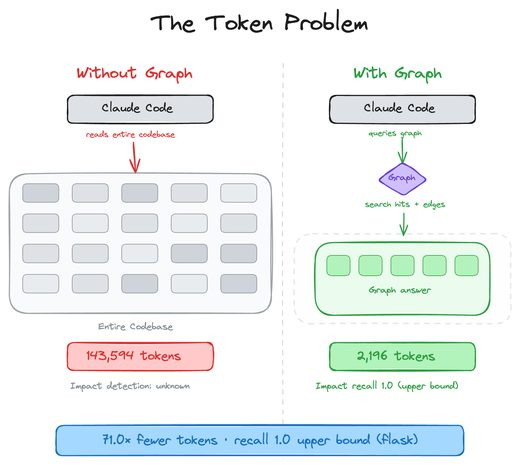</a> <a href="https://github.com/tirth8205/code-review-graph">tirth8205/code-review-graph</a></td>
<td align="center" valign="top"><a href="https://github.com/kenn-io/roborev">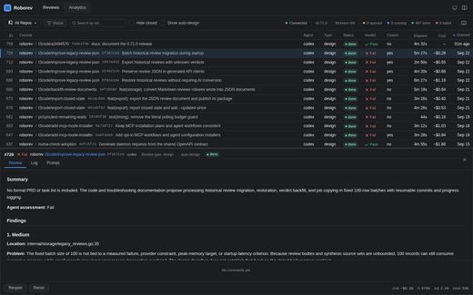</a> <a href="https://github.com/kenn-io/roborev">kenn-io/roborev</a></td>
</tr></table>

| Repo | Stars | What it does | Security |
|---|---:|---|---|
| [alibaba/open-code-review](https://github.com/alibaba/open-code-review) | 48.5k | Secure, fast, efficient, battle-tested at Alibaba's scale. Hybrid architecture code review tool: deterministic pipelines + LLM Agent, precise line-le… | [SAFE](https://agentskillshub.top/skill/alibaba/open-code-review/?utm_source=github&utm_medium=awesome-list) |
| [tirth8205/code-review-graph](https://github.com/tirth8205/code-review-graph) | 32.4k | Local-first code intelligence graph for MCP and CLI. Builds a persistent map of your codebase so AI coding tools read only what matters, with benchma… | [SAFE](https://agentskillshub.top/skill/tirth8205/code-review-graph/?utm_source=github&utm_medium=awesome-list) |
| [kenn-io/roborev](https://github.com/kenn-io/roborev) | 1.8k | Continuous background code review database for agents, work faster and smarter with accountability for every line of generated code. | [SAFE](https://agentskillshub.top/skill/kenn-io/roborev/?utm_source=github&utm_medium=awesome-list) |
| [HexmosTech/git-lrc](https://github.com/HexmosTech/git-lrc) | 1.5k | Free, Micro AI Code Reviews That Run on Git Commit | [SAFE](https://agentskillshub.top/skill/HexmosTech/git-lrc/?utm_source=github&utm_medium=awesome-list) |
| [sashiko-dev/sashiko](https://github.com/sashiko-dev/sashiko) | 1.4k | Agentic review of Linux Kernel code changes | [SAFE](https://agentskillshub.top/skill/sashiko-dev/sashiko/?utm_source=github&utm_medium=awesome-list) |
| [Gentleman-Programming/gentleman-guardian-angel](https://github.com/Gentleman-Programming/gentleman-guardian-angel) | 1.2k | 😇 Gentleman Guardian Angel (gga) - Provider-agnostic code review using AI. Use Claude, Gemini, Codex, Ollama to enforce your coding standards. | [SAFE](https://agentskillshub.top/skill/Gentleman-Programming/gentleman-guardian-angel/?utm_source=github&utm_medium=awesome-list) |
| [persiyanov/herdr-reviewr](https://github.com/persiyanov/herdr-reviewr) | 950 | Review your agent's diff in a terminal pane and send comments back to Claude Code, Codex, OpenCode or Pi. A herdr plugin. | [SAFE](https://agentskillshub.top/skill/persiyanov/herdr-reviewr/?utm_source=github&utm_medium=awesome-list) |
| [nilbuild/diffity](https://github.com/nilbuild/diffity) | 895 | Mac app to review the code written by you or your agent with Claude in the loop. | [SAFE](https://agentskillshub.top/skill/nilbuild/diffity/?utm_source=github&utm_medium=awesome-list) |
| [devagrawal09/jev-review](https://github.com/devagrawal09/jev-review) | 690 | A staged code-review workflow and local dashboard built with TypeSafe Jev. | [SAFE](https://agentskillshub.top/skill/devagrawal09/jev-review/?utm_source=github&utm_medium=awesome-list) |
| [imbue-ai/vet](https://github.com/imbue-ai/vet) | 511 | Find issues worth your attention. | [SAFE](https://agentskillshub.top/skill/imbue-ai/vet/?utm_source=github&utm_medium=awesome-list) |
| [taovc/pr-cockpit](https://github.com/taovc/pr-cockpit) | 485 | Local AI PR workbench — Claude/Codex review in isolated git worktrees, human-gated GitHub comments | [SAFE](https://agentskillshub.top/skill/taovc/pr-cockpit/?utm_source=github&utm_medium=awesome-list) |
| [getsentry/warden](https://github.com/getsentry/warden) | 418 | Your code is under new management. Agents that review your code. | [SAFE](https://agentskillshub.top/skill/getsentry/warden/?utm_source=github&utm_medium=awesome-list) |
| [lakeday-org/perch](https://github.com/lakeday-org/perch) | 353 | Semantic code and security scanner | [SAFE](https://agentskillshub.top/skill/lakeday-org/perch/?utm_source=github&utm_medium=awesome-list) |
| [TheMorpheus407/RepoLens](https://github.com/TheMorpheus407/RepoLens) | 302 | Multi-lens code audit tool — 280 expert AI agents for code review, security testing, and infrastructure auditing | [SAFE](https://agentskillshub.top/skill/TheMorpheus407/RepoLens/?utm_source=github&utm_medium=awesome-list) |
| [ReviewStage/stage-cli](https://github.com/ReviewStage/stage-cli) | 274 | A viewer for reviewing local code changes in small individual chapters. Works with any AI agent. | [SAFE](https://agentskillshub.top/skill/ReviewStage/stage-cli/?utm_source=github&utm_medium=awesome-list) |
| [NiazMorshed2007/jev-review](https://github.com/NiazMorshed2007/jev-review) | 247 | Local-first MCP plugin for continuous software-quality review by AI coding agents, powered by Jev. | [SAFE](https://agentskillshub.top/skill/NiazMorshed2007/jev-review/?utm_source=github&utm_medium=awesome-list) |
| [openqa-cn/codexqa](https://github.com/openqa-cn/codexqa) | 235 | codexqa: 11 local-first Agent Skills for Cursor, Claude Code, Codex & OpenClaw — change impact analysis, AI code review, defect scan, testcase genera… | [SAFE](https://agentskillshub.top/skill/openqa-cn/codexqa/?utm_source=github&utm_medium=awesome-list) |
| [wong2/diffx](https://github.com/wong2/diffx) | 217 | A local code review tool designed for the coding agent workflow | [SAFE](https://agentskillshub.top/skill/wong2/diffx/?utm_source=github&utm_medium=awesome-list) |
| [Ataraxy-Labs/inspect](https://github.com/Ataraxy-Labs/inspect) | 208 | Entity-level code review. Triages pull requests by structural risk using cross-file dependency graphs and LLMs that read for meaning. | [SAFE](https://agentskillshub.top/skill/Ataraxy-Labs/inspect/?utm_source=github&utm_medium=awesome-list) |
| [tshemsedinov/reslop](https://github.com/tshemsedinov/reslop) | 188 | 👁️ Review AI generated code and plan changes | [SAFE](https://agentskillshub.top/skill/tshemsedinov/reslop/?utm_source=github&utm_medium=awesome-list) |
| [puemos/lareview](https://github.com/puemos/lareview) | 182 | The code review workbench. | [SAFE](https://agentskillshub.top/skill/puemos/lareview/?utm_source=github&utm_medium=awesome-list) |
| [egma-ai/jev-code-reviewer](https://github.com/egma-ai/jev-code-reviewer) | 148 | Review behavior, not just diffs. Jev prioritizes human attention; OpenAI explains the changes. Local CLI + agent skill + GitHub extension. | [SAFE](https://agentskillshub.top/skill/egma-ai/jev-code-reviewer/?utm_source=github&utm_medium=awesome-list) |
| [Gil2015/code-gate](https://github.com/Gil2015/code-gate) | 127 | Intelligent Git commit code reviewer. Supports local (Ollama) and cloud models (DeepSeek, OpenAI, Anthropic) with a rich CLI UI. 本地AI智能 Git 提交代码审查工具。… | [SAFE](https://agentskillshub.top/skill/Gil2015/code-gate/?utm_source=github&utm_medium=awesome-list) |
| [vuphongle/oss-pr-reviewer](https://github.com/vuphongle/oss-pr-reviewer) | 114 | AI-powered CLI for reviewing GitHub pull requests, detecting potential bugs, security risks, regressions, and missing tests, with structured Markdown… | [SAFE](https://agentskillshub.top/skill/vuphongle/oss-pr-reviewer/?utm_source=github&utm_medium=awesome-list) |
| [nicobailon/pi-review-loop](https://github.com/nicobailon/pi-review-loop) | 111 | Automated code review loop extension for Pi coding agent | [SAFE](https://agentskillshub.top/skill/nicobailon/pi-review-loop/?utm_source=github&utm_medium=awesome-list) |
| [Ali-Marandi/AI-Code-Reviewer](https://github.com/Ali-Marandi/AI-Code-Reviewer) | 109 | AI-Powered Code Review and Quality Analysis Tool | [SAFE](https://agentskillshub.top/skill/Ali-Marandi/AI-Code-Reviewer/?utm_source=github&utm_medium=awesome-list) |
| [reviu-dev/reviu](https://github.com/reviu-dev/reviu) | 98 | The review app for code your agent writes. Native Rust/GPUI desktop app with real Git workflows. | [SAFE](https://agentskillshub.top/skill/reviu-dev/reviu/?utm_source=github&utm_medium=awesome-list) |
| [hyperb1iss/lucidity-mcp](https://github.com/hyperb1iss/lucidity-mcp) | 90 | AI-powered code quality analysis using MCP to help AI assistants review code more effectively. Analyze git changes for complexity, security issues, a… | [SAFE](https://agentskillshub.top/skill/hyperb1iss/lucidity-mcp/?utm_source=github&utm_medium=awesome-list) |
| [snakyvine/codex-maintainer](https://github.com/snakyvine/codex-maintainer) | 85 | Evidence-grounded issue triage, pull request review, and release notes for GitHub maintainers. CLI + GitHub Action. | [SAFE](https://agentskillshub.top/skill/snakyvine/codex-maintainer/?utm_source=github&utm_medium=awesome-list) |
| [mikker/semantic-review](https://github.com/mikker/semantic-review) | 82 | Semantic diff review for coding agents | [SAFE](https://agentskillshub.top/skill/mikker/semantic-review/?utm_source=github&utm_medium=awesome-list) |
| [katarmal-ram/codemoot](https://github.com/katarmal-ram/codemoot) | 78 | Multi-model collaborative development platform — Claude + GPT debate, review, and build together | [SAFE](https://agentskillshub.top/skill/katarmal-ram/codemoot/?utm_source=github&utm_medium=awesome-list) |
| [n24q02m/crg](https://github.com/n24q02m/crg) | 76 | Knowledge graph for token-efficient code reviews -- semantic search and call-graph resolution across your codebase. | [SAFE](https://agentskillshub.top/skill/n24q02m/crg/?utm_source=github&utm_medium=awesome-list) |
| [in-the-loop-labs/pair-review](https://github.com/in-the-loop-labs/pair-review) | 70 | AI assisted code review with a human in the loop | [SAFE](https://agentskillshub.top/skill/in-the-loop-labs/pair-review/?utm_source=github&utm_medium=awesome-list) |
| [simion/reviewd](https://github.com/simion/reviewd) | 70 | Local AI pull request reviewer — review GitHub and BitBucket PRs right from your terminal, powered by the Claude Code, Gemini, and Codex CLIs. | [SAFE](https://agentskillshub.top/skill/simion/reviewd/?utm_source=github&utm_medium=awesome-list) |
| [kunkka19xx/lgtm](https://github.com/kunkka19xx/lgtm) | 65 | Read what your agent wrote before you say LGTM. A fast TUI in Zig for reviewing code with vim motions. | [CAUTION](https://agentskillshub.top/skill/kunkka19xx/lgtm/?utm_source=github&utm_medium=awesome-list) |
| [bobmatnyc/ai-code-review](https://github.com/bobmatnyc/ai-code-review) | 56 | AI-powered code review CLI with multiple providers (Gemini, Claude, OpenAI). Features 95%+ token reduction via semantic chunking, 7 review types (sec… | [SAFE](https://agentskillshub.top/skill/bobmatnyc/ai-code-review/?utm_source=github&utm_medium=awesome-list) |
| [kodehash/katichai](https://github.com/kodehash/katichai) | 52 | Context-aware, AI-assisted code review CLI tool that prevents unnecessary AI-generated code, detects duplicated logic, enforces architectural pattern… | [CAUTION](https://agentskillshub.top/skill/kodehash/katichai/?utm_source=github&utm_medium=awesome-list) |
| [get-tmonier/argot](https://github.com/get-tmonier/argot) | 51 | A statistical code analyzer built from your repository's history. | [SAFE](https://agentskillshub.top/skill/get-tmonier/argot/?utm_source=github&utm_medium=awesome-list) |
| [giorgiop/AICodePal](https://github.com/giorgiop/AICodePal) | 51 | An AI-managed open-source code review and assistance tool to help developers write better, more efficient, and secure code. | [SAFE](https://agentskillshub.top/skill/giorgiop/AICodePal/?utm_source=github&utm_medium=awesome-list) |
| [ScanLineDev/scanline](https://github.com/ScanLineDev/scanline) | 50 | Expert AI code reviews Catch bugs before they hurt Run Scanline in your CLI to find: - race conditions - logical errors - security risks - optimizati… | [SAFE](https://agentskillshub.top/skill/ScanLineDev/scanline/?utm_source=github&utm_medium=awesome-list) |
| [dbachelder/slop-review](https://github.com/dbachelder/slop-review) | 50 | A native /slop-review window for Claude Code, Codex CLI, and pi — review the slop before you ship it. Monaco-powered inline comments, agent reads the… | [SAFE](https://agentskillshub.top/skill/dbachelder/slop-review/?utm_source=github&utm_medium=awesome-list) |
| [killop/code-review-skill](https://github.com/killop/code-review-skill) | 50 |  | [SAFE](https://agentskillshub.top/skill/killop/code-review-skill/?utm_source=github&utm_medium=awesome-list) |
| [xieziyu/duetlens](https://github.com/xieziyu/duetlens) | 50 | Conversational code review on macOS: review a PR or local branch together with a codex agent, and ask about any line instead of just reading its find… | [SAFE](https://agentskillshub.top/skill/xieziyu/duetlens/?utm_source=github&utm_medium=awesome-list) |
| [DiffoHQ/diffo](https://github.com/DiffoHQ/diffo) | 42 | Local, live code review for the AI age - read what the agent wrote and send feedback straight back | [SAFE](https://agentskillshub.top/skill/DiffoHQ/diffo/?utm_source=github&utm_medium=awesome-list) |
| [raye-deng/open-code-review](https://github.com/raye-deng/open-code-review) | 40 | 🤖 AI code quality gate for AI-generated code. Detects hallucinated packages, phantom dependencies, stale APIs, and more. MCP Server + CLI + CI/CD Act… | [SAFE](https://agentskillshub.top/skill/raye-deng/open-code-review/?utm_source=github&utm_medium=awesome-list) |
| [WillNigri/Agentic-Tool-Optimization](https://github.com/WillNigri/Agentic-Tool-Optimization) | 34 | Local-first multi-runtime AI cockpit (CLI + desktop + MCP). War-rooms, review receipts, open multi-model coding benchmarks. MIT. | [SAFE](https://agentskillshub.top/skill/WillNigri/Agentic-Tool-Optimization/?utm_source=github&utm_medium=awesome-list) |
| [amix/dunk](https://github.com/amix/dunk) | 31 | Review diffs in a terminal UI, leave inline comments, and let coding agents fix them | [SAFE](https://agentskillshub.top/skill/amix/dunk/?utm_source=github&utm_medium=awesome-list) |
| [logi-cmd/agent-guardrails](https://github.com/logi-cmd/agent-guardrails) | 27 | Checks AI-generated code changes before merge: scope, validation, risk, review evidence, and optional Verity receipts. | [SAFE](https://agentskillshub.top/skill/logi-cmd/agent-guardrails/?utm_source=github&utm_medium=awesome-list) |
| [ispuppy/ai-pre-commit-reviewer](https://github.com/ispuppy/ai-pre-commit-reviewer) | 24 | AI-powered git pre-commit hook for automated code review with customizable rules. | [SAFE](https://agentskillshub.top/skill/ispuppy/ai-pre-commit-reviewer/?utm_source=github&utm_medium=awesome-list) |
| [ahoybuoy/buoy](https://github.com/ahoybuoy/buoy) | 20 | Design system guardian for code. Anchors to design system, catches drift in React/Vue/Tailwind, reviews PRs automatically. Free for open source. | [SAFE](https://agentskillshub.top/skill/ahoybuoy/buoy/?utm_source=github&utm_medium=awesome-list) |
| [itsmesherry/claude-audit](https://github.com/itsmesherry/claude-audit) | 15 | Command-line code auditor: fast static checks, plus an optional audit where Claude investigates the code with read-only tools. | [CAUTION](https://agentskillshub.top/skill/itsmesherry/claude-audit/?utm_source=github&utm_medium=awesome-list) |
| [umitkavala/revet](https://github.com/umitkavala/revet) | 12 | Code review agent | [SAFE](https://agentskillshub.top/skill/umitkavala/revet/?utm_source=github&utm_medium=awesome-list) |
| [CommitBrief/commitbrief](https://github.com/CommitBrief/commitbrief) | 11 | Local LLM code review CLI for git diffs — review staged/unstaged changes, any git diff range, or a GitHub PR, right in your terminal. | [SAFE](https://agentskillshub.top/skill/CommitBrief/commitbrief/?utm_source=github&utm_medium=awesome-list) |
| [DanielT777/sieve](https://github.com/DanielT777/sieve) | 11 | Filter AI slop before it hits your codebase. A structured human review workflow for AI-generated code. | [SAFE](https://agentskillshub.top/skill/DanielT777/sieve/?utm_source=github&utm_medium=awesome-list) |
| [alxnddr/reviewer](https://github.com/alxnddr/reviewer) | 11 | UI for agent-generated code reviews | [SAFE](https://agentskillshub.top/skill/alxnddr/reviewer/?utm_source=github&utm_medium=awesome-list) |
| [matheusfillipe/diffler](https://github.com/matheusfillipe/diffler) | 11 | Terminal code review with vi-like bindings. Live diffs, comments the agent answers, PR review, MCP built in. | [SAFE](https://agentskillshub.top/skill/matheusfillipe/diffler/?utm_source=github&utm_medium=awesome-list) |
| [narghev/askdiff](https://github.com/narghev/askdiff) | 11 | Ask your AI questions about its own code changes — from a Git diff viewer. | [SAFE](https://agentskillshub.top/skill/narghev/askdiff/?utm_source=github&utm_medium=awesome-list) |
| [zanetworker/highstakes](https://github.com/zanetworker/highstakes) | 11 | AI writes code faster than you can review it. HighStakes reads your codebase, scores every file by blast radius, and tells you where human review mat… | [SAFE](https://agentskillshub.top/skill/zanetworker/highstakes/?utm_source=github&utm_medium=awesome-list) |
| [mantacron/manta](https://github.com/mantacron/manta) | 10 | 20 AI agents in your git workflow. Secrets, injection flaws and unsafe migrations are blocked at commit; performance, coverage and the rest are revie… | [SAFE](https://agentskillshub.top/skill/mantacron/manta/?utm_source=github&utm_medium=awesome-list) |
| [jsliapark/preflight](https://github.com/jsliapark/preflight) | 8 | ⚡ Preflight — AI code review before you open the PR Multi-agent system that gives instant, senior-level feedback on git diffs. | [SAFE](https://agentskillshub.top/skill/jsliapark/preflight/?utm_source=github&utm_medium=awesome-list) |
| [verabravo/diffback](https://github.com/verabravo/diffback) | 8 | Local web UI to review AI-generated code changes and generate structured feedback prompts | [SAFE](https://agentskillshub.top/skill/verabravo/diffback/?utm_source=github&utm_medium=awesome-list) |
| [voodootikigod/adversarial-review](https://github.com/voodootikigod/adversarial-review) | 8 | Skeptical ship/no-ship adversarial code review of a git diff or branch — runs against any LLM (API or local CLI agent) | [SAFE](https://agentskillshub.top/skill/voodootikigod/adversarial-review/?utm_source=github&utm_medium=awesome-list) |
| [witold-andelie/revio](https://github.com/witold-andelie/revio) | 8 | Agentic code review CLI — LangGraph orchestrates 13 deterministic static analyzers (oxlint/bandit/clippy/spotbugs/golangci/cppcheck) + LLM reasoning… | [SAFE](https://agentskillshub.top/skill/witold-andelie/revio/?utm_source=github&utm_medium=awesome-list) |
| [agent-0x/claude-codex-review](https://github.com/agent-0x/claude-codex-review) | 7 | Dual-AI automated code review: Codex finds issues, Claude fixes them — loop until clean. | [SAFE](https://agentskillshub.top/skill/agent-0x/claude-codex-review/?utm_source=github&utm_medium=awesome-list) |
| [Open-Document-Alliance/Agent-Review-CLI](https://github.com/Open-Document-Alliance/Agent-Review-CLI) | 6 | A CLI that orchestrates parallel AI coding agents to reciew, fix and ship code changes | [SAFE](https://agentskillshub.top/skill/Open-Document-Alliance/Agent-Review-CLI/?utm_source=github&utm_medium=awesome-list) |

## 🛡 Security review

[Open this type on the live page, sorted by stars →](https://agentskillshub.top/best/code-review/?utm_source=github&utm_medium=awesome-list#type-security)

<table><tr>
<td align="center" valign="top"><a href="https://github.com/agentgg-dev/agentgg">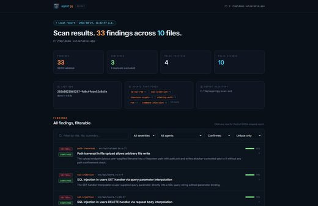</a> <a href="https://github.com/agentgg-dev/agentgg">agentgg-dev/agentgg</a></td>
<td align="center" valign="top"><a href="https://github.com/tanviet12/vbsec">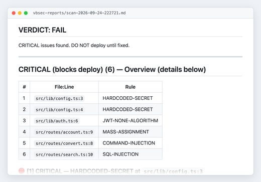</a> <a href="https://github.com/tanviet12/vbsec">tanviet12/vbsec</a></td>
<td align="center" valign="top"><a href="https://github.com/Addepar/RedFlag">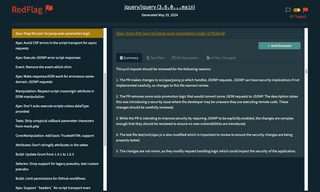</a> <a href="https://github.com/Addepar/RedFlag">Addepar/RedFlag</a></td>
</tr></table>

| Repo | Stars | What it does | Security |
|---|---:|---|---|
| [lintsinghua/DeepAudit](https://github.com/lintsinghua/DeepAudit) | 7.2k | DeepAudit：人人拥有的 AI 黑客战队，让漏洞挖掘触手可及。小白一键部署运行，自主协作审计 + 自动化沙箱 PoC 验证。支持 Ollama 私有部署 ，一键生成报告。支持中转站。​让安全不再昂贵，让审计不再复杂。 | [SAFE](https://agentskillshub.top/skill/lintsinghua/DeepAudit/?utm_source=github&utm_medium=awesome-list) |
| [anthropics/claude-code-security-review](https://github.com/anthropics/claude-code-security-review) | 6.6k | An AI-powered security review GitHub Action using Claude to analyze code changes for security vulnerabilities. | [SAFE](https://agentskillshub.top/skill/anthropics/claude-code-security-review/?utm_source=github&utm_medium=awesome-list) |
| [google/mantis](https://github.com/google/mantis) | 2.6k | A modular, stack-agnostic toolkit for AI coding agents to autonomously find, reproduce, and patch vulnerabilities. | [SAFE](https://agentskillshub.top/skill/google/mantis/?utm_source=github&utm_medium=awesome-list) |
| [arm/metis](https://github.com/arm/metis) | 888 | Metis is an open-source, AI-driven tool for deep security code review | [SAFE](https://agentskillshub.top/skill/arm/metis/?utm_source=github&utm_medium=awesome-list) |
| [agentgg-dev/agentgg](https://github.com/agentgg-dev/agentgg) | 442 | Open source agentic SAST. The engine behind hundreds of disclosed zero-days. 100+ AI security agents, any repo or PR diff, bring your own model. | [SAFE](https://agentskillshub.top/skill/agentgg-dev/agentgg/?utm_source=github&utm_medium=awesome-list) |
| [tanviet12/vbsec](https://github.com/tanviet12/vbsec) | 312 | Security scanning skill for Claude Code, Codex and Antigravity. Finds the 21 most common vulnerabilities in AI-written code and shows how to fix each… | [SAFE](https://agentskillshub.top/skill/tanviet12/vbsec/?utm_source=github&utm_medium=awesome-list) |
| [AgriciDaniel/claude-cybersecurity](https://github.com/AgriciDaniel/claude-cybersecurity) | 256 | PYA (Protect Your Ass): security audit plugin for Claude Code. 9 specialist agents, a dated threat feed, verified findings, offline by default. | [SAFE](https://agentskillshub.top/skill/AgriciDaniel/claude-cybersecurity/?utm_source=github&utm_medium=awesome-list) |
| [Addepar/RedFlag](https://github.com/Addepar/RedFlag) | 163 | RedFlag uses AI to identify high-risk code changes. Run it in batch mode for release candidate testing or in CI pipelines to flag PRs and add reviewe… | [SAFE](https://agentskillshub.top/skill/Addepar/RedFlag/?utm_source=github&utm_medium=awesome-list) |
| [EastSword/skill-dfyx_code_security_review](https://github.com/EastSword/skill-dfyx_code_security_review) | 144 | 东方隐侠团队出品，代码审计skill | [SAFE](https://agentskillshub.top/skill/EastSword/skill-dfyx_code_security_review/?utm_source=github&utm_medium=awesome-list) |
| [DeepCodeAI/vscode-extension](https://github.com/DeepCodeAI/vscode-extension) | 129 | DeepCode extension for Visual Studio Code | [SAFE](https://agentskillshub.top/skill/DeepCodeAI/vscode-extension/?utm_source=github&utm_medium=awesome-list) |
| [momenbasel/vulnhawk](https://github.com/momenbasel/vulnhawk) | 90 | AI-powered SAST scanner that finds auth bypass, IDOR, and logic bugs Semgrep/CodeQL miss. Free GitHub Action. Supports Python, JS/TS, Go, PHP, Ruby. | [SAFE](https://agentskillshub.top/skill/momenbasel/vulnhawk/?utm_source=github&utm_medium=awesome-list) |
| [shivamsaraswat/SeCoRA](https://github.com/shivamsaraswat/SeCoRA) | 58 | Secure Code Review AI Agent (SeCoRA) - AI SAST | [SAFE](https://agentskillshub.top/skill/shivamsaraswat/SeCoRA/?utm_source=github&utm_medium=awesome-list) |
| [fabriziosalmi/brutal-coding-tool](https://github.com/fabriziosalmi/brutal-coding-tool) | 27 | Audit your vibecode and make it brutally solid :) | [SAFE](https://agentskillshub.top/skill/fabriziosalmi/brutal-coding-tool/?utm_source=github&utm_medium=awesome-list) |
| [oscaar90/OpsGuard-AI](https://github.com/oscaar90/OpsGuard-AI) | 17 | Context Aware Security Gate for GitHub Actions. Validates deployments using Hybrid Analysis (Deterministic Rules + LLM Reasoning). | [SAFE](https://agentskillshub.top/skill/oscaar90/OpsGuard-AI/?utm_source=github&utm_medium=awesome-list) |
| [win4r/jev-security-scan](https://github.com/win4r/jev-security-scan) | 11 | 使用 TypeSafe Jev 审查 Skill 与 MCP 可疑行为 \| Review Agent Skills and MCP code with Jev, static evidence, and explicit coverage gaps | [SAFE](https://agentskillshub.top/skill/win4r/jev-security-scan/?utm_source=github&utm_medium=awesome-list) |
| [vikram-codes-hub/codesense-ai](https://github.com/vikram-codes-hub/codesense-ai) | 7 | AI-powered code review platform that automatically analyzes GitHub PRs for security vulnerabilities, bugs, and complexity issues — posts inline comme… | [CAUTION](https://agentskillshub.top/skill/vikram-codes-hub/codesense-ai/?utm_source=github&utm_medium=awesome-list) |

## 👥 Multi-agent review

[Open this type on the live page, sorted by stars →](https://agentskillshub.top/best/code-review/?utm_source=github&utm_medium=awesome-list#type-multi)

<table><tr>
<td align="center" valign="top"><a href="https://github.com/codexstar69/bug-hunter">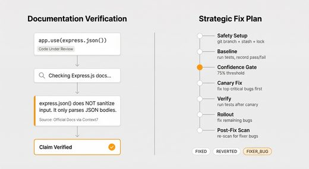</a> <a href="https://github.com/codexstar69/bug-hunter">codexstar69/bug-hunter</a></td>
<td align="center" valign="top"><a href="https://github.com/chorus-codes/chorus">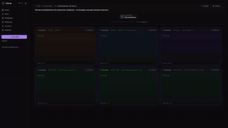</a> <a href="https://github.com/chorus-codes/chorus">chorus-codes/chorus</a></td>
<td align="center" valign="top"><a href="https://github.com/spencermarx/open-code-review">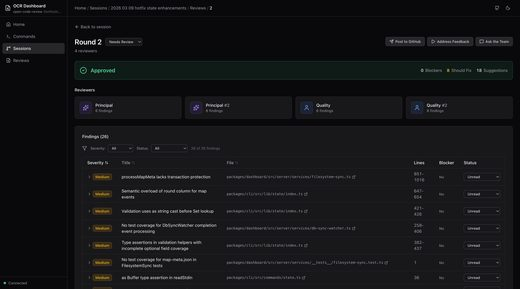</a> <a href="https://github.com/spencermarx/open-code-review">spencermarx/open-code-review</a></td>
</tr></table>

| Repo | Stars | What it does | Security |
|---|---:|---|---|
| [Agent-Field/pr-af](https://github.com/Agent-Field/pr-af) | 659 | #1 open-source code reviewer on Code-Review-Bench | [SAFE](https://agentskillshub.top/skill/Agent-Field/pr-af/?utm_source=github&utm_medium=awesome-list) |
| [codexstar69/bug-hunter](https://github.com/codexstar69/bug-hunter) | 538 | Adversarial AI bug hunter with auto-fix skill for Claude Code, Cursor, Codex CLI, GitHub Copilot CLI, Kiro CLI, Opencode, Pi Coding Agent, and more.… | [SAFE](https://agentskillshub.top/skill/codexstar69/bug-hunter/?utm_source=github&utm_medium=awesome-list) |
| [chorus-codes/chorus](https://github.com/chorus-codes/chorus) | 534 | Multi-LLM peer review for code decisions. Bring your own CLI; Chorus convenes 2-4 other LLMs to review the work before you ship. | [SAFE](https://agentskillshub.top/skill/chorus-codes/chorus/?utm_source=github&utm_medium=awesome-list) |
| [spencermarx/open-code-review](https://github.com/spencermarx/open-code-review) | 382 | AI-powered multi-agent code review. Simulates a customizable team of Engineers performing code review with built-in discourse. | [SAFE](https://agentskillshub.top/skill/spencermarx/open-code-review/?utm_source=github&utm_medium=awesome-list) |
| [adamjgmiller/adamsreview](https://github.com/adamjgmiller/adamsreview) | 245 | Multi-lens code review pipeline for Claude Code: deep review (Claude or Codex), auto-fix loop, interactive walkthrough, external-finding injection. | [SAFE](https://agentskillshub.top/skill/adamjgmiller/adamsreview/?utm_source=github&utm_medium=awesome-list) |
| [99xAgency/GodModeSkill](https://github.com/99xAgency/GodModeSkill) | 239 | Multi-LLM cross-review workflow for Claude Code. /work orchestrates plan/implement/bug-fix with 3 different model families voting on every gate. | [SAFE](https://agentskillshub.top/skill/99xAgency/GodModeSkill/?utm_source=github&utm_medium=awesome-list) |
| [syabro/rejudge](https://github.com/syabro/rejudge) | 167 | Independent multi-model review for AI coding agents | [SAFE](https://agentskillshub.top/skill/syabro/rejudge/?utm_source=github&utm_medium=awesome-list) |
| [amElnagdy/review-skills](https://github.com/amElnagdy/review-skills) | 163 | Two-model debate review of PRs and MRs, plus a babysitter that works the review rounds. Skills for any coding agent. | [SAFE](https://agentskillshub.top/skill/amElnagdy/review-skills/?utm_source=github&utm_medium=awesome-list) |
| [VirtusLab/tulip](https://github.com/VirtusLab/tulip) | 131 | Explains GitHub PRs in a human-friendly way, using LLMs. | [SAFE](https://agentskillshub.top/skill/VirtusLab/tulip/?utm_source=github&utm_medium=awesome-list) |
| [minetechnic2012-lang/claude-ops-inspector](https://github.com/minetechnic2012-lang/claude-ops-inspector) | 120 | Subagent Verification for Claude AI Code Networks 2026 | [SAFE](https://agentskillshub.top/skill/minetechnic2012-lang/claude-ops-inspector/?utm_source=github&utm_medium=awesome-list) |
| [Mte90/linus-torvalds-skill](https://github.com/Mte90/linus-torvalds-skill) | 115 | Distilled Code Reviewer skills/soul from 32k~ email from the kernel newsletter | [SAFE](https://agentskillshub.top/skill/Mte90/linus-torvalds-skill/?utm_source=github&utm_medium=awesome-list) |
| [GGGODLIN/claude-pr-review](https://github.com/GGGODLIN/claude-pr-review) | 114 | Multi-axis PR review orchestration for Claude Code — 5 independent review perspectives, symmetric cross-verification, deterministic coverage assertion | [SAFE](https://agentskillshub.top/skill/GGGODLIN/claude-pr-review/?utm_source=github&utm_medium=awesome-list) |
| [huoji120/code_review_agent](https://github.com/huoji120/code_review_agent) | 113 | 简洁高效的代码审计agent | [SAFE](https://agentskillshub.top/skill/huoji120/code_review_agent/?utm_source=github&utm_medium=awesome-list) |
| [umputun/revmux](https://github.com/umputun/revmux) | 108 | Multi-agent code review, supervised and auditable | [SAFE](https://agentskillshub.top/skill/umputun/revmux/?utm_source=github&utm_medium=awesome-list) |
| [ZJunCher/mr-agent](https://github.com/ZJunCher/mr-agent) | 93 | An open-source multi-agent platform for GitLab MR code review, governance, and CI self-healing. | [SAFE](https://agentskillshub.top/skill/ZJunCher/mr-agent/?utm_source=github&utm_medium=awesome-list) |
| [dalemoncayo/fullcase-web](https://github.com/dalemoncayo/fullcase-web) | 93 | A practical example of integrating AI code review into a real-world codebase. Built with Next.js and Firebase, this repo highlights structured prompt… | [CAUTION](https://agentskillshub.top/skill/dalemoncayo/fullcase-web/?utm_source=github&utm_medium=awesome-list) |
| [csy-csy123/pr-review-agent-council](https://github.com/csy-csy123/pr-review-agent-council) | 87 | 学习 learn-claude-code 后的 PR Review Agent 实践项目：构建 Debate Council 多 Agent 审查、Tool Calling、结构化报告与 AI Judge 评估。 | [SAFE](https://agentskillshub.top/skill/csy-csy123/pr-review-agent-council/?utm_source=github&utm_medium=awesome-list) |
| [kevinten-ai/ai-agent-agentscope-codereview](https://github.com/kevinten-ai/ai-agent-agentscope-codereview) | 68 | 基于 AgentScope Java SDK 的智能代码审查 AI Agent，同时作为 AgentScope 框架学习教程。涵盖 ReAct 模式、工具系统、多 Agent 协作等核心概念。 | [SAFE](https://agentskillshub.top/skill/kevinten-ai/ai-agent-agentscope-codereview/?utm_source=github&utm_medium=awesome-list) |
| [MaxwellCCC/autonomous-qa-loop](https://github.com/MaxwellCCC/autonomous-qa-loop) | 65 | Portable fresh-agent QA loop prompt for finding bugs without biased self-checks / 通用自动 QA 循环 SKILL | [SAFE](https://agentskillshub.top/skill/MaxwellCCC/autonomous-qa-loop/?utm_source=github&utm_medium=awesome-list) |
| [addyosmani/adverse](https://github.com/addyosmani/adverse) | 62 | Multi-agent adversarial code review for any coding agent | [SAFE](https://agentskillshub.top/skill/addyosmani/adverse/?utm_source=github&utm_medium=awesome-list) |
| [AaronZ345/codebase-argus](https://github.com/AaronZ345/codebase-argus) | 58 | Multi-agent codebase review for PRs, CI, and downstream fork syncs. | [CAUTION](https://agentskillshub.top/skill/AaronZ345/codebase-argus/?utm_source=github&utm_medium=awesome-list) |
| [ncoevoet/claude-review-all](https://github.com/ncoevoet/claude-review-all) | 44 | Comprehensive multi-agent code review for Claude Code | [SAFE](https://agentskillshub.top/skill/ncoevoet/claude-review-all/?utm_source=github&utm_medium=awesome-list) |
| [leocder07/spectra](https://github.com/leocder07/spectra) | 19 | 8 AI agents grade your entire repository across 6 dimensions — signed, verifiable A+ to F audit reports in minutes | [SAFE](https://agentskillshub.top/skill/leocder07/spectra/?utm_source=github&utm_medium=awesome-list) |
| [ZephyrDeng/pi-review](https://github.com/ZephyrDeng/pi-review) | 16 | Isolated AI-powered code and plan reviews from the command line | [SAFE](https://agentskillshub.top/skill/ZephyrDeng/pi-review/?utm_source=github&utm_medium=awesome-list) |
| [FreHu/claude-maintainability-review](https://github.com/FreHu/claude-maintainability-review) | 11 | Claude Code workflow to grade your project's maintainability by Human and LLM | [SAFE](https://agentskillshub.top/skill/FreHu/claude-maintainability-review/?utm_source=github&utm_medium=awesome-list) |
| [wdnmd1265/Audison](https://github.com/wdnmd1265/Audison) | 11 | Stop trusting single AI outputs. An anti-hallucination framework with dual-brain arbitration, multi-model audit, and evidence chains for LLM quality… | [SAFE](https://agentskillshub.top/skill/wdnmd1265/Audison/?utm_source=github&utm_medium=awesome-list) |

## 🏗 Code review platforms

[Open this type on the live page, sorted by stars →](https://agentskillshub.top/best/code-review/?utm_source=github&utm_medium=awesome-list#type-platform)

| Repo | Stars | What it does | Security |
|---|---:|---|---|
| [px0-ai/px0](https://github.com/px0-ai/px0) | 1.9k | px0 is a review workbench and speed-first IDE built for AI-generated code. It turns your browser into a zero-latency console with native Git and GitH… | [SAFE](https://agentskillshub.top/skill/px0-ai/px0/?utm_source=github&utm_medium=awesome-list) |
| [kodustech/kodus-ai](https://github.com/kodustech/kodus-ai) | 1.5k | Open source, self-hosted AI code review. Bring your own LLM. | [SAFE](https://agentskillshub.top/skill/kodustech/kodus-ai/?utm_source=github&utm_medium=awesome-list) |
| [miracodeai/mira](https://github.com/miracodeai/mira) | 379 | Self-hosted AI code reviewer with indexed PR reviews, walkthroughs, vulnerability scanning, dependency graphs, custom rules, and a learning loop. | [SAFE](https://agentskillshub.top/skill/miracodeai/mira/?utm_source=github&utm_medium=awesome-list) |
| [domvwt/chatgpt-code-review](https://github.com/domvwt/chatgpt-code-review) | 289 |  | [SAFE](https://agentskillshub.top/skill/domvwt/chatgpt-code-review/?utm_source=github&utm_medium=awesome-list) |
| [FelixNg1022/cf_ai_code_review](https://github.com/FelixNg1022/cf_ai_code_review) | 169 | AI-powered code review application built on Cloudflare Workers | [SAFE](https://agentskillshub.top/skill/FelixNg1022/cf_ai_code_review/?utm_source=github&utm_medium=awesome-list) |
| [devarshishimpi/codra](https://github.com/devarshishimpi/codra) | 125 | Self-hosted AI code review for GitHub pull requests, built on Cloudflare Workers. | [SAFE](https://agentskillshub.top/skill/devarshishimpi/codra/?utm_source=github&utm_medium=awesome-list) |
| [seoes/proval](https://github.com/seoes/proval) | 119 | Self-Hosted LLM Code Review Agent for GitLab, Forgejo and GitHub. Local LLM support | [SAFE](https://agentskillshub.top/skill/seoes/proval/?utm_source=github&utm_medium=awesome-list) |
| [imDarshanGK/AI-dev-assistant](https://github.com/imDarshanGK/AI-dev-assistant) | 83 | AI-powered code analysis tool with bug detection, code explanations, and AI-powered suggestions. | [SAFE](https://agentskillshub.top/skill/imDarshanGK/AI-dev-assistant/?utm_source=github&utm_medium=awesome-list) |
| [HexmosTech/LiveReview](https://github.com/HexmosTech/LiveReview) | 68 | Risk-Aware AI Code Review for Business-Critical Systems | [CAUTION](https://agentskillshub.top/skill/HexmosTech/LiveReview/?utm_source=github&utm_medium=awesome-list) |

**Security** is the grade of the repo's README and install steps on Agent Skills Hub. *pending* means the catalog has not graded it yet.

Preview images are reduced copies of pictures from each project's own README, included only for projects under a permissive license. Sources and licenses: [assets/previews/NOTICE.md](assets/previews/NOTICE.md). Open an issue to have one removed.

## Related collections

- [zhuyansen/awesome-claude-video-skills](https://github.com/zhuyansen/awesome-claude-video-skills), [zhuyansen/awesome-codex-ppt-skills](https://github.com/zhuyansen/awesome-codex-ppt-skills) — lists built the same way.

## Add a repo

Open an issue with the GitHub URL. It goes through the same review as every entry; the rules above decide, stars do not.

---

Machine-readable copy: [`data/skills.json`](data/skills.json). Generated 2026-10-27.
